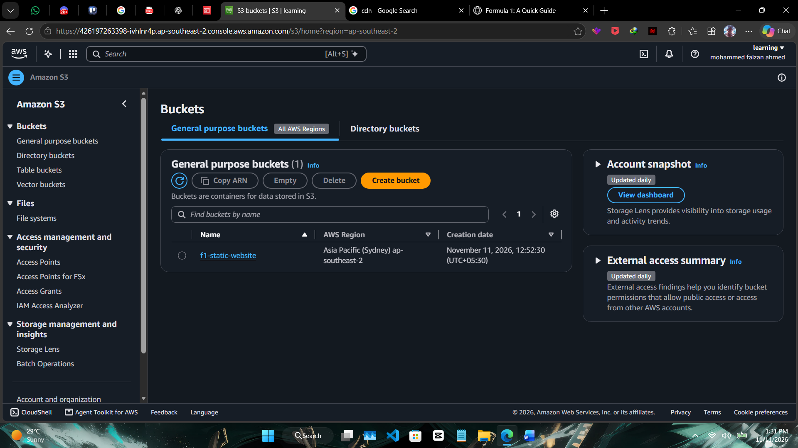
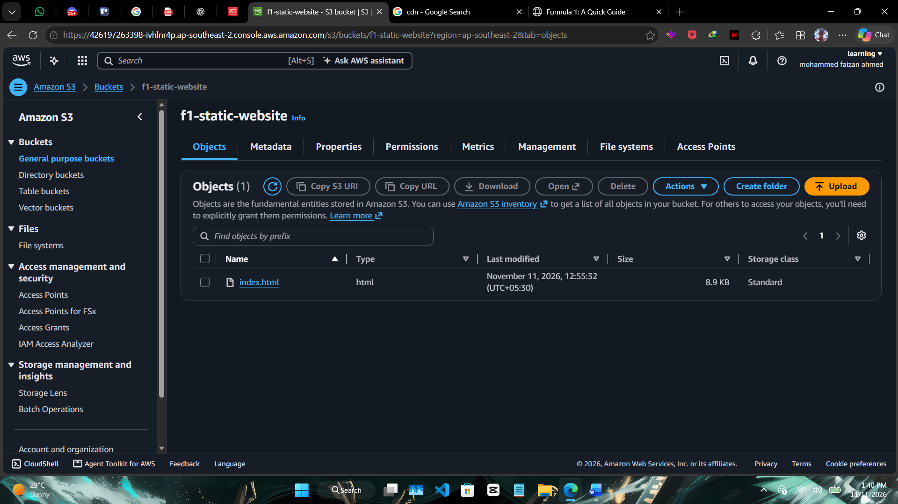
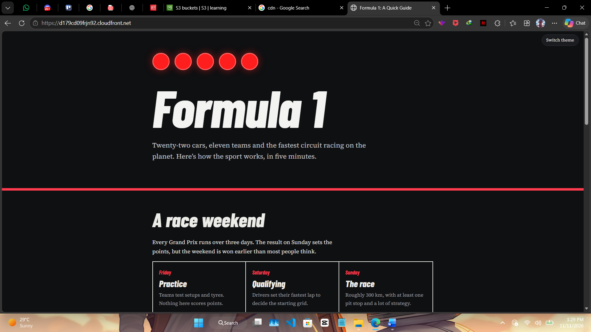
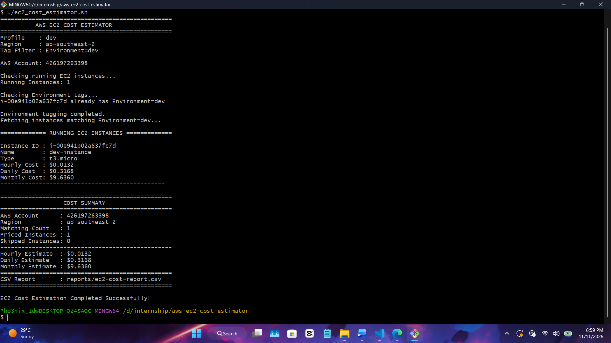

# AWS DevOps Hands-On Projects

This repository documents two AWS DevOps hands-on tasks:

1. **Deploy a Static Website using Amazon S3 and CloudFront CDN**
2. **AWS EC2 Cost Estimator using Shell Scripting**

The projects demonstrate AWS storage, content delivery, IAM permissions, EC2 resource discovery, tag-based automation, and cost estimation.

## Table of Contents

- [1. Static Website Hosting with S3 and CloudFront](#1-static-website-hosting-with-s3-and-cloudfront)
  - [1.1 Objective](#11-objective)
  - [1.2 Architecture](#12-architecture)
  - [1.3 Technologies Used](#13-technologies-used)
  - [1.4 Implementation Steps](#14-implementation-steps)
  - [1.5 Configuration Summary](#15-configuration-summary)
  - [1.6 IAM Permissions and Security](#16-iam-permissions-and-security)
  - [1.7 Deployment Result](#17-deployment-result)
- [2. AWS EC2 Cost Estimator](#2-aws-ec2-cost-estimator)
  - [2.1 Overview](#21-overview)
  - [2.2 Features](#22-features)
  - [2.3 Technologies Used](#23-technologies-used)
  - [2.4 Required IAM Permissions](#24-required-iam-permissions)
  - [2.5 Configuration](#25-configuration)
  - [2.6 Installation and Execution](#26-installation-and-execution)
  - [2.7 Cost Estimation](#27-cost-estimation)
  - [2.8 CSV Report](#28-csv-report)
  - [2.9 Limitations](#29-limitations)
  - [2.10 Future Improvements](#210-future-improvements)
- [3.Author](#3-author)

---

# 1. Static Website Hosting with S3 and CloudFront

## 1.1 Objective

The objective of this task was to deploy a static website on AWS using **Amazon S3** and **Amazon CloudFront**.

Amazon S3 stores and hosts the website files, while CloudFront acts as a Content Delivery Network (CDN), distributing website content through global edge locations and providing HTTPS access to visitors.

**Website:** Formula 1 – A Quick Guide  
**Deployment type:** Static website hosting

## 1.2 Architecture

The deployment follows this request flow:

```text
User / Web Browser
        |
        | HTTPS
        v
Amazon CloudFront CDN
        |
        | HTTP (S3 static website endpoint)
        v
Amazon S3 Static Website
        |
        v
index.html and website assets
```

### Architecture Components

| Component | Purpose |
|---|---|
| User / Web Browser | Requests and displays the website |
| Amazon CloudFront | Delivers website content through global edge locations |
| Amazon S3 | Stores and hosts HTML, CSS, JavaScript, and other static assets |
| HTTPS | Secures the connection between the visitor's browser and CloudFront |
| AWS IAM | Controls permissions for users and services managing AWS resources |

**How the request works:**

1. A visitor opens the CloudFront URL using a web browser.
2. CloudFront receives the request over HTTPS.
3. CloudFront retrieves the requested content from the S3 static website endpoint.
4. CloudFront returns the website content to the visitor over HTTPS.

> **Origin protocol note:** The S3 static website endpoint is configured as a custom HTTP origin because S3 website endpoints do not support HTTPS connections. HTTPS is provided between the visitor's browser and CloudFront.

## 1.3 Technologies Used

| Technology | Purpose |
|---|---|
| Amazon S3 | Stores and hosts static website files |
| Amazon CloudFront | Provides global content delivery and HTTPS access |
| AWS IAM | Manages AWS resource access permissions |
| HTML | Structures website content |
| CSS | Styles the website |
| HTTPS | Secures browser-to-CloudFront communication |

## 1.4 Implementation Steps

### Step 1: Create an Amazon S3 Bucket

1. Signed in to the AWS Management Console.
2. Opened the Amazon S3 service.
3. Selected **Create bucket**.
4. Entered a globally unique bucket name.
5. Selected the required AWS Region.
6. Disabled **Block all public access** for this traditional public S3 static website hosting setup.
7. Kept ACLs disabled.
8. Created the bucket.

**Screenshot – S3 bucket created:**



### Step 2: Enable Static Website Hosting

1. Opened the newly created S3 bucket.
2. Navigated to the **Properties** tab.
3. Located the **Static website hosting** section.
4. Selected **Edit**.
5. Enabled static website hosting.
6. Selected **Host a static website**.
7. Set the index document to `index.html`.

| Setting | Configuration |
|---|---|
| Static website hosting | Enabled |
| Hosting type | Host a static website |
| Index document | `index.html` |

### Step 3: Upload Website Files

The website created for this task was **Formula 1 – A Quick Guide**.

The main HTML file, `index.html`, was uploaded to the root directory of the S3 bucket. The uploaded file contains the website's HTML structure, styling, and content.

**Screenshot – Website file uploaded to S3:**



### Step 4: Configure the S3 Bucket Policy

A bucket policy was configured to allow visitors to read website objects.

Example policy used for the `f1-static-website` bucket:

```json
{
  "Version": "2012-10-17",
  "Statement": [
    {
      "Sid": "PublicReadForStaticWebsite",
      "Effect": "Allow",
      "Principal": "*",
      "Action": "s3:GetObject",
      "Resource": "arn:aws:s3:::f1-static-website/*"
    }
  ]
}
```

**Purpose of the policy:**

- Allows visitors to read website objects.
- Does not grant public upload or delete permissions.
- Restricts public access to the `s3:GetObject` action on objects in the bucket.

> **Security note:** This is a public-read S3 website configuration, matching the lab implementation. For production workloads, consider a private S3 bucket with CloudFront Origin Access Control (OAC), rather than enabling public bucket access. Do not store confidential information in a public website bucket.

### Step 5: Test the S3 Static Website

1. Navigated to **Properties → Static website hosting**.
2. Copied the S3 website endpoint.
3. Opened the endpoint in a web browser.
4. Verified that the Formula 1 website loaded successfully.

**Screenshot – S3 static website test:**


### Step 6: Create an Amazon CloudFront Distribution

A CloudFront distribution was created to improve content delivery performance and provide HTTPS access.

| Setting | Configuration |
|---|---|
| Origin domain | S3 static website endpoint |
| Origin type | Custom origin |
| Origin protocol policy | HTTP Only |
| Viewer protocol policy | Redirect HTTP to HTTPS |
| Allowed HTTP methods | GET, HEAD |
| Default root object | `index.html` |
| CDN service | Amazon CloudFront |

### Step 7: Deploy and Verify CloudFront

1. Created the CloudFront distribution.
2. Waited until the distribution status changed to **Deployed**.
3. Copied the assigned CloudFront domain name.
4. Opened the URL in a web browser.
5. Verified that the Formula 1 website loaded successfully over HTTPS.

**Screenshot – Website served through CloudFront:**



## 1.5 Configuration Summary

| Component | Deployment configuration |
|---|---|
| Website | Formula 1 – A Quick Guide |
| S3 bucket | `f1-static-website` |
| Storage | Amazon S3 |
| Static website hosting | Enabled |
| Index document | `index.html` |
| CDN | Amazon CloudFront |
| Origin | S3 static website endpoint |
| Origin connection | HTTP |
| Viewer connection | HTTPS |
| Viewer protocol policy | Redirect HTTP to HTTPS |
| Allowed methods | GET, HEAD |
| Website accessibility | Successfully tested |

## 1.6 IAM Permissions and Security

IAM was used to manage permissions for AWS resources.

### A. IAM Identity Policy

The deployment IAM user or role requires appropriate permissions to manage website files. The lab document provides the following example permissions:

| Permission | Purpose |
|---|---|
| `s3:ListBucket` | Lists objects in the website bucket |
| `s3:PutObject` | Uploads website files |
| `s3:GetObject` | Reads website objects |
| `s3:DeleteObject` | Deletes website objects |

This example is for website file management. It does not include CloudFront distribution administration permissions.

### B. S3 Bucket Policy

The S3 bucket policy grants public read access to website objects through `s3:GetObject`. It does not grant visitors permission to upload or delete objects.

### Security Considerations

- Restrict IAM permissions to authorized users.
- Do not grant public upload or delete permissions.
- Do not store confidential information in a publicly readable website bucket.
- Use HTTPS for visitor access through CloudFront.
- For a production deployment, prefer a private S3 origin with CloudFront OAC where possible.

## 1.7 Deployment Result

**Deployment status:** Successfully deployed and tested.

**Live Website:** [Formula 1 – A Quick Guide](https://d179cd09frjn92.cloudfront.net)

The CloudFront distribution was created and deployed. The website was successfully opened and tested using its CloudFront domain over HTTPS.

---

# 2. AWS EC2 Cost Estimator

## 2.1 Overview

A Shell-based automation tool that identifies running Amazon EC2 instances in an AWS account, filters them using resource tags, and generates an estimated cost summary.

It also supports automatically tagging running instances that do not have the configured environment tag.

The project automates the process of identifying running EC2 instances in a development AWS account and estimating their compute costs.

**GitHub Repository:** [hands-on-lab](https://github.com/sadequekhan46/hands-on-lab)

## 2.2 Features

- Retrieves running EC2 instances using the AWS CLI.
- Filters instances using configurable AWS tags.
- Automatically adds the configured environment tag to running instances that do not have it.
- Calculates estimated hourly, daily, and monthly costs.
- Displays a cost summary in the terminal.
- Generates a CSV report for further analysis.
- Supports configurable AWS profiles, Regions, and tag values.
- Handles instances with unsupported pricing entries.

## 2.3 Technologies Used

| Technology | Purpose |
|---|---|
| Shell Script (Bash) | Automation and cost calculations |
| AWS CLI | Communication with AWS services |
| Amazon EC2 | Retrieves compute instance information |
| `jq` | JSON processing |
| `awk` | Cost calculations |
| Git and GitHub | Version control and source code hosting |

## 2.4 Required IAM Permissions

The script requires the following IAM permissions:

| Permission | Purpose |
|---|---|
| `ec2:DescribeInstances` | Retrieves EC2 instance information |
| `ec2:CreateTags` | Adds the environment tag to untagged instances |
| `sts:GetCallerIdentity` | Verifies the AWS account identity |

> **Important:** Automatic tagging modifies AWS resources. The script tags every running EC2 instance in the configured Region that does not already have the selected tag. Verify the AWS account, profile, and Region before execution.

## 2.5 Configuration

The script uses the following default configuration:

| Variable | Default value | Description |
|---|---|---|
| `AWS_PROFILE` | `dev` | AWS CLI profile |
| `AWS_REGION` | `ap-southeast-2` | AWS Region |
| `TAG_KEY` | `Environment` | Tag key used for filtering |
| `TAG_VALUE` | `dev` | Tag value used for filtering |

Update these values according to your AWS environment and script configuration.

## 2.6 Installation and Execution

### Step 1: Clone the Repository

```bash
git clone https://github.com/sadequekhan46/hands-on-lab.git

### Step 2: Navigate to the Project Directory

```bash
cd hands-on-lab
```

### Step 3: Give Execution Permission

```bash
chmod +x ec2_cost_estimator.sh
```

### Step 4: Run the Script

```bash
./ec2_cost_estimator.sh
```

**Screenshot – EC2 Cost Estimator output:**



## 2.7 Cost Estimation

The script uses predefined hourly rates for supported EC2 instance types.

The cost calculations follow these formulas:

```text
Hourly Cost  = EC2 Instance Hourly Rate
Daily Cost   = Hourly Cost × 24
Monthly Cost = Hourly Cost × 730
```

The monthly calculation assumes 730 hours.

## 2.8 CSV Report

After execution, the script generates:

```text
reports/ec2-cost-report.csv
```

The report contains EC2 instance details and estimated costs. It can be opened using Microsoft Excel or another spreadsheet application.

## 2.9 Limitations

1. Cost estimates use predefined hourly rates rather than live AWS pricing.
2. Actual costs may vary by Region, operating system, and purchasing model.
3. EBS storage, snapshots, data transfer, taxes, and other AWS services are not included.
4. Only supported instance types with configured rates are included in the priced total.
5. Automatic tagging requires `ec2:CreateTags` permission and changes resource metadata.

## 2.10 Future Improvements

1. Integrate live AWS Pricing API data.
2. Add support for more EC2 instance types.
3. Generate HTML cost reports.
4. Add cost comparison between AWS Regions.
5. Integrate the script into a scheduled CI/CD workflow.

---

##  Author

**Khan Sadeque**  
Cloud & DevOps Intern | MCA Graduate

**GitHub:** [sadequekhan46](https://github.com/sadequekhan46)

---
